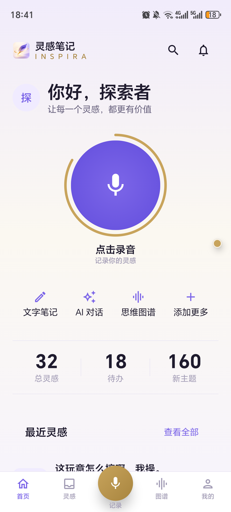
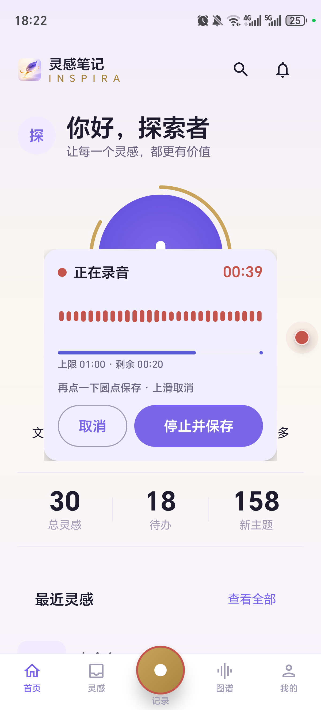
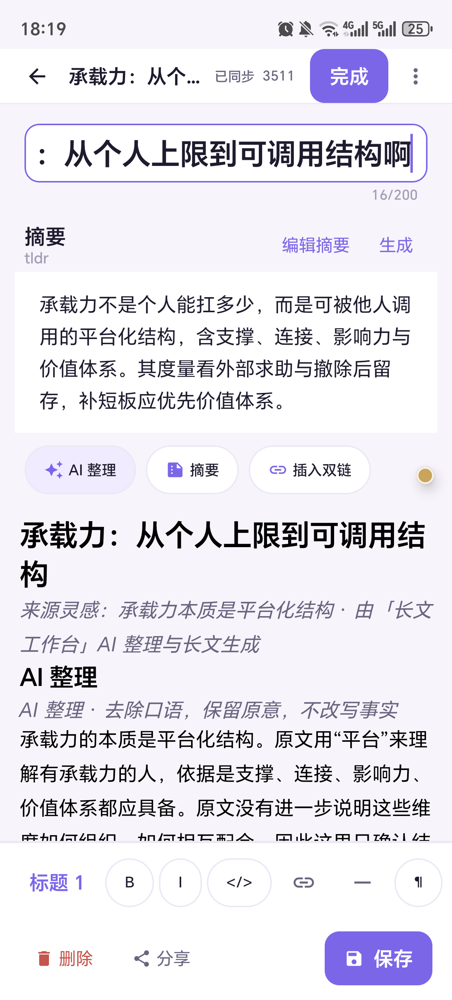
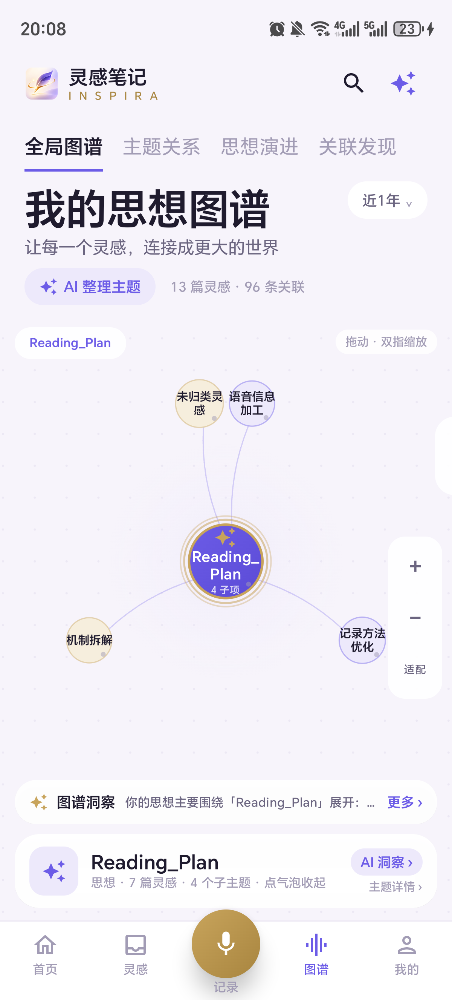
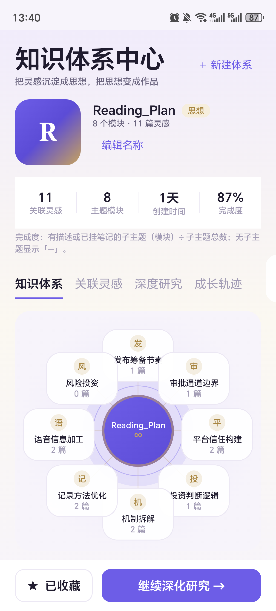
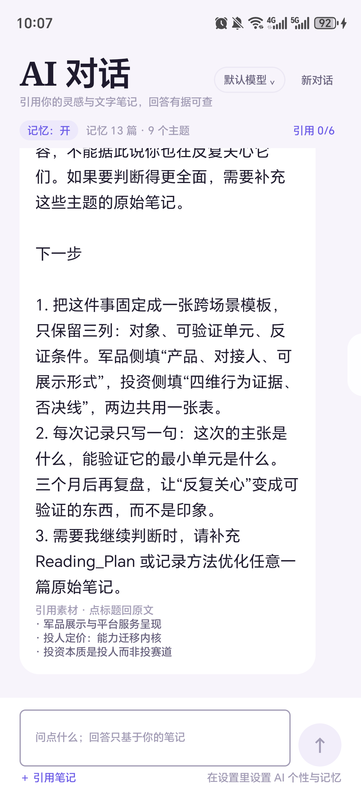
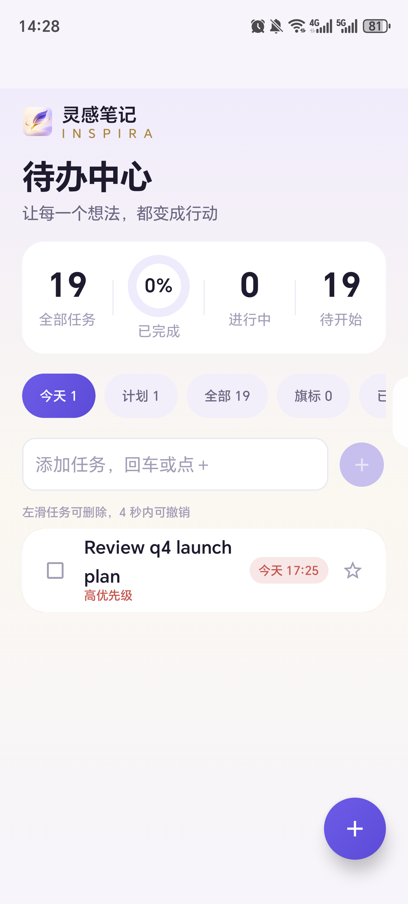
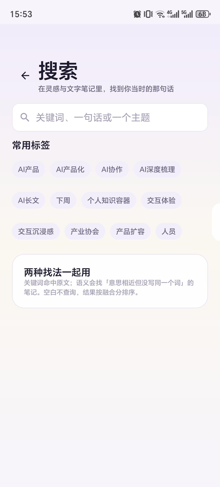
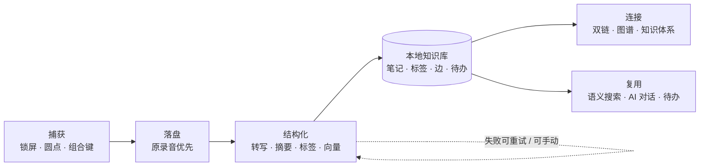
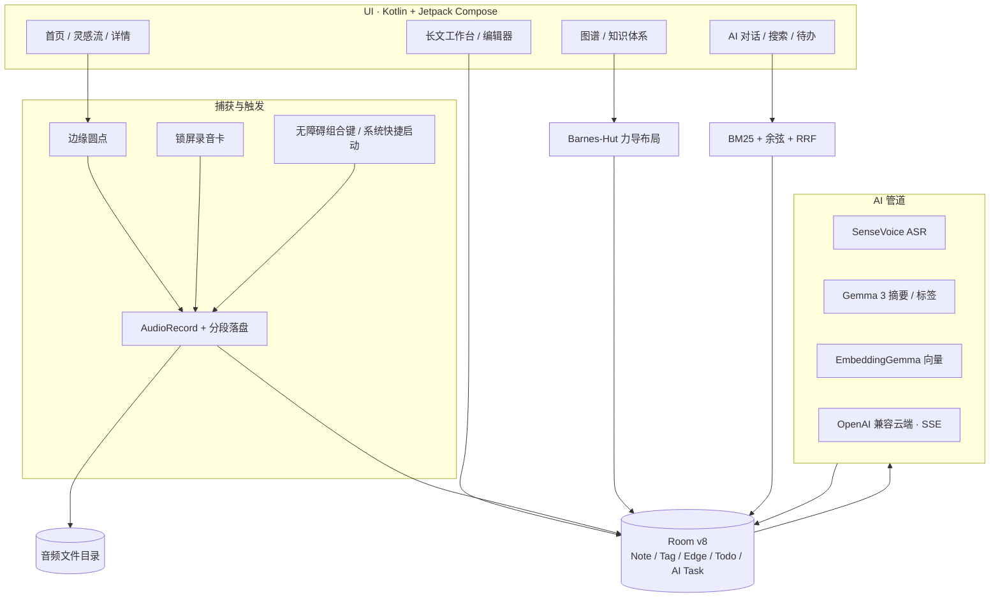

<div align="center">
  
  <h1>inSpira · 灵感笔记</h1>
  <p><strong>捕获灵感，让思想生长。</strong></p>
  <p>把一闪而过的想法，变成可检索、可连接、可生长的个人知识网络。</p>

  <p>
    
    
    
    
    
  </p>
</div>

---

大多数笔记工具解决“记下来”。inSpira 解决“记下来之后”。

它从锁屏和任意界面接住一条语音，在端侧完成转写、摘要、标签与向量索引；再把语音胶囊、长文、主题、双链和语义关系放进同一张知识网络。你可以搜一句模糊的描述，也可以直接问 AI——回答只基于你的笔记，引用能点回原文。

**应用名：灵感笔记　项目代号：inSpira　包名：`com.ideanote.app`**

## 目录

- [一眼看懂](#一眼看懂)
- [为什么是 inSpira](#为什么是-inspira)
- [核心能力](#核心能力)
- [端侧模型：按需下载，逐文件校验](#端侧模型按需下载逐文件校验)
- [快速开始](#快速开始)
- [技术架构](#技术架构)
- [工程与验证](#工程与验证)
- [已知边界与路线图](#已知边界与路线图)
- [仓库说明](#仓库说明)

## 一眼看懂

<table>
  <tr>
    <td align="center" width="33%">
      <br />
      <sub><b>首页</b> · 把录音放在拇指下</sub>
    </td>
    <td align="center" width="33%">
      <br />
      <sub><b>捕获</b> · 不离开当前界面</sub>
    </td>
    <td align="center" width="33%">
      <br />
      <sub><b>灵感流</b> · 每条都有摘要、标签与关联</sub>
    </td>
  </tr>
  <tr>
    <td align="center" width="33%">
      <br />
      <sub><b>长文工作台</b> · 原文 / AI 整理 / AI 长文 / 追问</sub>
    </td>
    <td align="center" width="33%">
      <br />
      <sub><b>思想图谱</b> · 主题枢纽与关联发现</sub>
    </td>
    <td align="center" width="33%">
      <br />
      <sub><b>知识体系</b> · 从灵感到作品的结构</sub>
    </td>
  </tr>
  <tr>
    <td align="center" width="33%">
      <br />
      <sub><b>AI 对话</b> · 回答只基于你的笔记，引用可回原文</sub>
    </td>
    <td align="center" width="33%">
      <br />
      <sub><b>待办中心</b> · AI 建议，人来决定</sub>
    </td>
    <td align="center" width="33%">
      <br />
      <sub><b>搜索</b> · 关键词与语义一起用</sub>
    </td>
  </tr>
</table>

## 为什么是 inSpira

只负责“记下来”的产品，在记录量超过几百条后会迅速退化成信息坟场：找不到、连不起来、用不上，记录行为本身也会衰减。

inSpira 把捕获当作入口，把**结构化、连接、复用**当作同等基础的结构层：



两条不妥协的约束：

1. **音频与原文是一等公民，AI 是增强层。** 任何模型失败、超时、缺权限、无网络，都不阻止保存与离开。
2. **本地优先，云端显式。** 不配置云端时，捕获、端侧转写、摘要、标签、向量与搜索照常工作；数据默认不出本机。

## 核心能力

### 01 · 捕获：灵感不该等解锁

- **常驻边缘小圆点**：单击开始/停止录音，长按呼出灵感队列；可拖动，不遮挡内容。
- **锁屏录音卡**：以锁屏可见的 Activity 承载录音卡，显示计时、波形、上限与剩余时间；熄屏也能被拉起，保存后回到锁屏。
- **系统手势与无障碍**：支持音量上 + 下按住 3 秒触发（部分机型需先把系统无障碍快捷方式改为“无”，否则会被读屏抢走）；Honor / MagicOS 的“熄屏双击音量下键”可绑定本应用，入口自动改道到锁屏录音卡。不同 ROM 的手势与后台限制不同，设置页给出绑定路径、冲突提示与自检。
- **先落盘，再增强**：松手后优先写音频与笔记占位行（架构预算 ≤100ms），转写和 AI 异步进行；进程被杀后可恢复。
- **取消不留空胶囊**：录音取消会清理占位行与 0 字节音频；默认 60 秒上限自动保存。

### 02 · 结构化：每条记录自带索引

- **端侧优先**：SenseVoice Small int8 做语音转写，Gemma 3 1B int4 做摘要与标签，EmbeddingGemma 2 270M 做语义向量。模型下载后本地推理，不依赖网络；未下载或推理失败时回落云端（若已配置）或规则整理。
- **云端可选**：兼容 OpenAI 协议，默认 DeepSeek；支持多模型目录、流式 SSE、停止生成。云端只在用户显式配置后启用。
- **失败不阻塞**：摘要、标签、向量都是异步增强层；失败保留原文与录音，可重试、可切换通道、可手动编辑。
- **校正不被覆盖**：用户编辑过的摘要与标签会标记为用户校正，AI 不再覆盖。
- **来源透明**：界面明确区分 AI 生成、规则提取、无向量等来源，不用规则结果冒充 AI。

### 03 · 长文工作台：从碎片到作品

- **四页签**：原文 / AI 整理 / AI 长文 / 追问。打开工作台不会改写原灵感，原录音与原文始终保留。
- **五种产出类型**：文章、报告、讲稿、方案、复盘。不同产出类型使用不同的结构提示词，而不是同一段文字换个标题。
- **两种落点**：“转为文字笔记”创建新的块级文档并打开编辑器；“存入知识体系”把新笔记挂到指定主题节点。
- **块级编辑与双链**：段落、标题、列表、引用、代码、图片、分割线；`[[标题]]` / `[[标题|别名]]` 保存即建边，支持反向链接。
- **版本历史**：长文保存时记录上一版，可回看与恢复。

### 04 · 连接：让知识自己长出来

- **思想图谱**：Compose Canvas 加自研 Barnes-Hut 力导布局，支持全局图谱、主题关系、思想演进、关联发现；节点可点击进入主题洞察。
- **知识体系中心**：以放射模块图展示一个体系的主题结构，统计关联灵感、主题模块、完成度与成长轨迹；六类创作产出由真实素材推导，规则大纲明确标注“非 AI 生成”。
- **三类边**：标签边、双链边、语义相似边。标签与双链在保存时写入，语义边由向量异步计算，打开图谱时不需要全量重算。
- **知识治理**：标签可改名、合并、删除；反向链接回答“谁引用了我”。

### 05 · 复用：找得到，也问得动

- **混合搜索**：FTS5 BM25 关键词通道与向量余弦语义通道并行，RRF 融合排序；结果可定位到命中段落并高亮。
- **AI 对话**：手动引用最多 6 篇笔记，或按问题自动检索前 3 篇；元问题检索零命中时回退最近 3 篇。回答下方列出真实注入的素材标题，点击可回原文；支持全局记忆开关、多模型切换、流式输出与停止生成。
- **深度研究**：检索先行、云端生成、引用必带；输出判断、机制、边界、要点与下一步，而不是一段泛泛的摘要。
- **待办中心**：AI 一次生成 3–6 条候选，用户确认后才进入待办；支持今天 / 计划 / 全部 / 旗标 / 已完成、自定义清单、子任务、优先级、旗标与系统提醒。
- **收藏与回看**：灵感、长文、知识体系都可以收藏，形成自己的复用入口。

### 06 · 数据主权：本地优先，随时带走

- **无账号体系**：笔记、标签、边、待办、音频都在本机；不注册、不上传、不依赖云端才能启动。
- **密钥加密**：云端 API Key 使用 Android Keystore 的 AES-256-GCM 加密存储，不写明文；换机或清除应用数据后需重新填写。
- **JSON 导入导出**：导出笔记、标签、待办、子任务、知识节点与挂载关系；支持复制 JSON 到剪贴板绕过文件选择器。导入按主键跳过已存在内容，不覆盖本机修改；导入后重建全文索引。
- **清空可控**：清空内容需要二次确认，会同时删除本地录音文件，操作前应先导出。

## 端侧模型：按需下载，逐文件校验

模型权重不打包进 APK（合计约 1GB）。首次使用时在 **设置 → 模型管理** 中按需下载，自动落位到应用私有目录 `files/models/<id>/`。

| 能力 | 模型 | 体积 | 运行方式 |
| --- | --- | ---: | --- |
| 语音转写 | SenseVoice-Small int8 + tokens | 228.15 MB + 308 KB | sherpa-onnx，端侧离线 |
| 摘要 / 标签 | Gemma 3 1B int4 | 557.34 MB | LiteRT-LM，两项能力共用 |
| 语义向量 | EmbeddingGemma 2 270M | 157.00 MB | LiteRT-LM，768d → 256d 归一化 |

模型资产托管在本仓库的 [models-v1 Release](https://github.com/thinkbugs/inspira/releases/tag/models-v1)。下载过程遵循三条规则：

- **逐文件校验**：每个文件下载后校验字节数与 SHA-256；坏文件删除并标记失败，不会把不完整模型当成可用。
- **文件级续传**：重试时跳过已校验文件，1GB 模型不需要从头再来。
- **状态可见**：设置页实时显示“下载中 NN%”，完成后该能力变为“端侧可用”；摘要与标签共用 Gemma 3，因此共享同一进度。

模型许可与转发条款见 [`models/LICENSES.md`](models/LICENSES.md)。

## 快速开始

### 环境要求

| 项 | 要求 |
| --- | --- |
| 系统 | Android 8.0（API 26）及以上 |
| 构建 | JDK 17、Android SDK 35、build-tools 34+ |
| 架构 | 当前设备构建只打包 `arm64-v8a` |
| 磁盘 | 工程构建约 2GB；端侧模型另需约 1GB |
| 设备 | 真机验收使用 Honor ALI-AN00 / Android 15；其他 ROM 可按权限自检页逐项适配 |

### 构建

```bash
# 1. 指定 Android SDK（或设置 ANDROID_HOME）
echo "sdk.dir=/path/to/AndroidSdk" > android/local.properties

# 2. 默认构建：不含端侧 ASR/LLM 桥，适合 UI 与业务开发
cd android
./gradlew assembleDebug

# 3. 设备构建：包含端侧 ASR/LLM，完整体验与真机验收使用
./gradlew assembleDebug -Pideanote.sherpa=true -Pideanote.llm=true

# 4. 安装
adb install -r app/build/outputs/apk/debug/app-debug.apk
```

Windows 下使用 `gradlew.bat`。发布包请使用 `android/tools/build-release.sh`：它会固定端侧门控，并在缺少 `-Pideanote.sherpa=true -Pideanote.llm=true` 时给出警告——默认构建虽然能成功，但不包含端侧模型桥，产物与真机验收的 App 不是同一个。

### 首次运行

1. 按引导授予麦克风、通知、悬浮窗、电池白名单等权限；需要锁屏组合键时再开启无障碍服务。
2. 在 **设置 → 模型管理** 下载转写 / 摘要 / 标签 / 向量模型；或先在 AI 通道配置云端 API Key。
3. 单击屏幕边缘小圆点开始录音；也可以从首页录音按钮、通知栏或系统手势进入。
4. 在 **数据与隐私** 中导出一次 JSON，确认数据可以随时带走。

## 技术架构



| 领域 | 选型与设计 |
| --- | --- |
| UI | Kotlin 2.0.21 + Jetpack Compose（Material 3），单 Activity，MVVM + Repository |
| 构建 | Gradle 8.13 + AGP 8.7.3；minSdk 26 / targetSdk 34 / compileSdk 35 |
| 存储 | Room v8（WAL）；FTS5 虚拟表；检测到 ROM 不支持 FTS5 时自动降级为普通表 + LIKE 关键词腿；音频独立文件目录 |
| 端侧 AI | sherpa-onnx SenseVoice Small；LiteRT-LM Gemma 3 1B int4；EmbeddingGemma 2 270M |
| 云端 AI | OpenAI 兼容协议；DeepSeek 默认；SSE 流式；多模型目录；失败回退端侧或规则 |
| 图谱 | Compose Canvas + 自研 Barnes-Hut O(n log n) 力导；后台协程布局、LOD 与按需渲染 |
| 检索 | FTS5 BM25 ∥ 向量余弦 → RRF 融合；命中锚点回原文并高亮 |
| 安全 | Android Keystore AES-256-GCM 加密 API Key；release 构建强制空默认 Key，并用护栏单测阻止密钥进入 dex |
| 任务 | `ai_tasks` 表状态机驱动转写、摘要、标签、向量与语义边；失败可重试，杀进程可恢复 |

## 工程与验证

- **全量 JVM 单测 921 例通过**（0 失败 / 0 错误 / 0 跳过，2026-11-11）。
- **真机记录逐项留痕**：锁屏录音、端侧转写、长文工作台、图谱、知识体系、AI 对话、待办提醒、混合搜索等均有真机截图、数据库或 `dumpsys` 证据。
- **PASS / PARTIAL / NOT-RUN 分列**：没跑过的项不会被写成通过；受 ROM 限制或需要物理按键的项会明确标注待复验。
- **静态护栏**：发布包密钥、门控构建、关键装配位均有测试或源码锚点，避免“构建成功但产物不是同一个 App”。

## 已知边界与路线图

- 端侧模型需要单独下载，首次使用前需在设置中完成；不下载时可使用云端通道或手动模式。
- 锁屏手势由 ROM 提供，悬浮窗、后台与无障碍策略因厂商而异；设置页提供权限自检、冲突提示与降级路径。
- 云端能力需要用户自己的 API Key；不配置时不影响捕获、端侧转写与本地知识库。
- 正在推进：更多 ROM 的锁屏与手势适配、研究问答落库、重复提醒、端侧模型按设备能力分级。

## 仓库说明

本仓库托管 inSpira 的产品介绍、端侧模型 Release 资产与验证记录。模型权重不进入 Git，统一放在 [models-v1](https://github.com/thinkbugs/inspira/releases/tag/models-v1)；Android 工程源码与设计 / 验收文档按发布节奏同步。

如果这个项目对你有启发，欢迎 Star、提 Issue，或直接用它记录下一条灵感。
